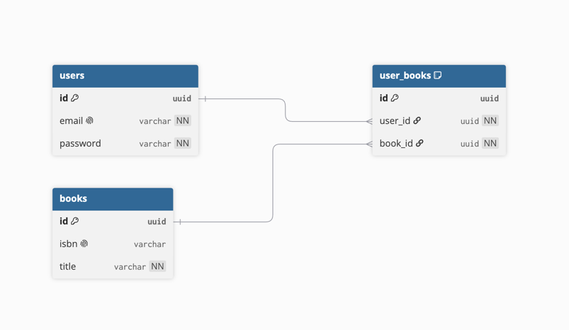

# ERD

# ERD

MyShelf의 초기 데이터 모델.

현재는 핵심 도메인만 정의하고 있으며,
기능이 추가됨에 따라 점진적으로 확장할 예정.

## Diagram



## Entities

### users

사용자 정보를 저장.

| Column | Type | Constraint | Description |
|---|---|---|---|
| id | uuid | PK | 사용자 식별자 |
| email | varchar | NOT NULL, UNIQUE | 로그인 이메일 |
| password | varchar | NOT NULL | 암호화된 비밀번호 |

### books

도서의 공통 정보를 저장.

`id`는 시스템 내부 식별자로 사용하고, `isbn`은 외부 도서 API 연동 및 도서 판본 식별을 위한 비즈니스 식별자로 사용

| Column | Type | Constraint | Description |
|---|---|---|---|
| id | uuid | PK | 도서 식별자 |
| isbn | varchar | UNIQUE | ISBN |
| title | varchar | NOT NULL | 도서명 |

### user_books

사용자와 도서의 N:M 관계를 해소하는 관계 엔티티.

사용자의 서재에 등록된 도서 한 건을 의미하며,
향후 독서 상태, 평점, 시작일/완독일 등의 사용자별 정보를 추가할 예정.

| Column | Type | Constraint | Description |
|---|---|---|---|
| id | uuid | PK | 사용자 도서 식별자 |
| user_id | uuid | FK, NOT NULL | 사용자 식별자 |
| book_id | uuid | FK, NOT NULL | 도서 식별자 |

## Relationships

```text
users 1 ─── N user_books N ─── 1 books