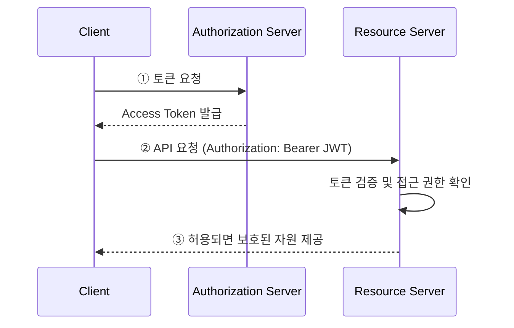

# OAuth2의 역할과 MyShelf의 Resource Server

> MyShelf 학습 문서 · 기준: 2026-10-23  
> 범위: Authorization Server와 Resource Server의 역할, JWT 요청과 `permitAll()`의 관계  
> 관련 문서: [로그인 인증과 JWT 발급](./login-authentication-and-jwt-issuance.md), [JWT 기반 API 요청 인증](./jwt-request-authentication.md)

## 1. OAuth2에서 구분하는 역할

OAuth2에서는 **토큰을 발급하는 역할**과 **토큰을 이용해 보호된 자원을 제공하는 역할**을 구분한다.

| 역할 | 하는 일 |
| --- | --- |
| Client | 사용자 대신 토큰을 얻고, 토큰을 첨부하여 API를 호출하는 애플리케이션 |
| Authorization Server | 클라이언트가 사용할 Access Token을 발급하는 서버 |
| Resource Server | Access Token을 검증하고 접근 정책에 따라 보호된 API·데이터를 제공하는 서버 |



**역할 구분이 물리적인 서버 분리를 뜻하지는 않는다.** 하나의 애플리케이션이 토큰 발급과 API 제공을 모두 담당할 수도 있다.

## 2. MyShelf에는 어떻게 적용되는가?

MyShelf는 하나의 Spring Boot 애플리케이션 안에서 다음 두 역할을 수행한다.

- **토큰 발급:** `POST /auth/login`에서 이메일·비밀번호 인증에 성공하면 `NimbusJwtEncoder`를 이용해 JWT Access Token을 발급한다.
- **보호된 API 제공:** `oauth2ResourceServer(oauth2 -> oauth2.jwt(...))` 설정을 통해 Spring Security가 요청의 Bearer JWT를 검증한다.

현재 MyShelf의 토큰 발급 기능은 **자체 로그인 기반 JWT 발급**이지, OAuth2의 전체 프로토콜을 구현한 **완전한 Authorization Server**는 아니다. 다만 API 요청 인증에는 Spring Security의 **OAuth2 Resource Server 기능을 재사용**한다.

```text
로그인: Client → LoginController → 이메일·비밀번호 인증 → JWT 발급
API:    Client → SecurityFilterChain → JWT 검증 → 접근 허용 시 Controller
```

`JwtConfig`는 Encoder와 Decoder에 같은 SecretKey와 HS256을 적용한다. Decoder는 기본 시간 검증에 MyShelf의 `sub` UUID 정규식 검증을 추가한다. 인증 실패 응답은 `ProblemDetailAuthenticationEntryPoint`가 기본 Bearer 상태 코드·헤더 처리를 유지하면서 JSON 본문을 작성한다.

## 3. `permitAll()`과 JWT 검증은 왜 별개인가?

`permitAll()`은 **인증이 없어도 해당 경로에 접근할 수 있다는 인가 규칙**이다. `SecurityFilterChain`의 실행이나 첨부된 Bearer 토큰의 검증을 생략한다는 뜻은 아니다.

예를 들어 `POST /auth/login`, `POST /users`가 `permitAll()`인 경우:

| 요청 | Spring Security 처리 |
| --- | --- |
| Bearer 토큰 없음 | JWT 인증 시도 없이 진행 → Controller 실행 |
| 유효한 Bearer JWT 첨부 | JWT 인증 성공 → Controller 실행 |
| 만료·변조된 Bearer JWT 첨부 | JWT 인증 실패 → 일반적으로 `401 Unauthorized` |

**"로그인에는 토큰이 없어야 한다"는 검사는 없다.** 토큰이 *필수가 아닐 뿐*이다. 토큰이 있다면 `BearerTokenAuthenticationFilter`가 인증을 시도하므로, 잘못된 토큰 때문에 `permitAll()` 경로에서도 요청이 거부될 수 있다.

또한 유효한 JWT를 로그인 API에 첨부했다고 해서 이메일·비밀번호를 통한 **로그인 자체가 자동 성공하는 것은 아니다.** 로그인 Controller는 별도로 자격 증명을 확인한다.

### 통합 테스트를 통한 확인

`JwtRequestAuthenticationIntegrationTest`에서는
`permitAll()`이 적용된 로그인 API에 잘못된 Bearer Token을
첨부했을 때 HTTP 401과 `WWW-Authenticate` 헤더,
`AUTHENTICATION_FAILED` 코드의 ProblemDetail JSON이 반환되는지 검증했다.

이 사례를 포함해 현재 7개 테스트 메서드의 총 8개 실행 사례가 통과했다. 공개 API의 무토큰 접근은 기존 로그인·회원가입 통합 테스트가 담당하므로 JWT 테스트 클래스에 복제하지 않았다.

이는 `permitAll()`이 인증 필터의 실행을 생략하는
설정이 아니라는 점을 보여준다.

인증(Authentication)과 인가(Authorization)는
서로 다른 책임을 가지며, 기본 필터 구성에서는
Bearer Token 인증 처리가 인가 판단보다 먼저 수행된다.

토큰이 없는 인증 필요 경로에서는 `AuthorizationFilter`의 접근 거부를 `ExceptionTranslationFilter`가 처리해 EntryPoint를 호출한다. 반면 잘못된 JWT는 Bearer 인증 필터의 실패 처리 경로에서 EntryPoint로 연결된다. 자세한 호출 흐름과 `commence()`의 의미는 [JWT 요청 인증 문서의 실패 처리](./jwt-request-authentication.md#7-인증-실패하면-어떻게-되는가)를 참고한다.

## 4. 기억할 핵심

- **JWT:** 인증 정보를 표현하고 서명할 수 있는 *토큰 형식*.
- **Authorization Server:** Access Token을 *발급하는 역할*.
- **Resource Server:** Access Token을 이용해 보호된 자원에 대한 요청을 *인증·인가하는 역할*.
- **Spring Security Resource Server:** MyShelf에서 JWT 요청 인증의 표준 처리 흐름을 제공하는 기능.
- **`permitAll()`:** 토큰을 금지하거나 인증 필터를 건너뛰는 설정이 아니라, *인증 없이 접근을 허용하는 인가 규칙*.

### 참고 자료

- [Spring Security — OAuth2 Resource Server](https://docs.spring.io/spring-security/reference/servlet/oauth2/resource-server/index.html)
- [Spring Security — JWT Resource Server](https://docs.spring.io/spring-security/reference/servlet/oauth2/resource-server/jwt.html)
