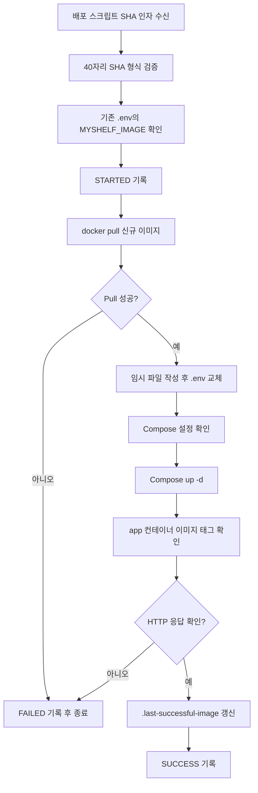

# EC2 자동 배포 스크립트와 배포 검증

> 기록 기준: 2026-11-13 · `scripts/deploy-ec2.sh` 기반 SSH 배포
>
> 목표: **배포 스크립트가 인자를 전달받은 순간부터 실제 컨테이너 교체와 기록 완료까지 무엇을 수행하는지 이해한다.**

## 1. 배포 환경

- AWS EC2: Ubuntu 24.04, ARM64 `t4g.small` (2 vCPU, 2 GiB)
- 배포 디렉터리: `/opt/myshelf`
- Compose 파일: `compose.yaml` + `compose.prod.yaml`
- 서비스: `app`(Spring Boot), `postgres`(PostgreSQL 17), `redis`(Redis 7)
- 이미지 저장소: `ghcr.io/pickylemon/myshelf`
- 외부 호스트 포트: 애플리케이션 `127.0.0.1:8080:8080` 바인딩. PostgreSQL·Redis는 호스트에 별도 공개 포트를 설정하지 않음
- 배포 방식: GitHub Actions → SCP로 배포 파일 전송 → SSH로 `deploy-ec2.sh` 실행

**현재 방식은 단일 EC2의 Docker Compose 배포다.** 블루·그린이나 무중단 교체를 보장하지 않는다.

## 2. 파일들의 책임

| 파일 | 역할 | 갱신 주체 |
| --- | --- | --- |
| `compose.yaml` | 공통 서비스·볼륨·네트워크 구성 | Git에 버전 관리, CD가 전송 |
| `compose.prod.yaml` | 운영 이미지·프로필 등 운영 전용 설정 | Git에 버전 관리, CD가 전송 |
| `deploy-ec2.sh` | 이미지 교체 실행 절차 | Git에 버전 관리, CD가 전송 |
| `.env` | DB/JWT/API 키 등 운영 환경변수 및 `MYSHELF_IMAGE` 배포 대상 값 | EC2 로컬 보관, 스크립트가 이미지 항목만 수정 |
| `deployment-history.log` | 배포 시작·성공·실패 이벤트 기록 | 스크립트가 추가 기록 |
| `.last-successful-image` | 마지막으로 스크립트 검증을 통과한 이미지 태그 | 검증 성공 시 덮어씀 |

`.env`는 **단순한 이력 파일이 아니라 Docker Compose가 배포할 이미지 버전과 운영 환경변수를 읽는 설정 파일**이다. 배포 실패 후에도 새 이미지 값이 남을 수 있으므로 `.env` 내용만으로 **현재 정상 동작 중임을 보증하지는 않는다**.

## 3. 전체 배포 순서



실제 스크립트에는 잘못된 인자 또는 필수 파일 누락 등을 조기에 거부하는 검사도 있다. **오류 기록용 `trap`을 등록하기 전에 실패한 검증은 `FAILED` 기록이 남지 않을 수 있다.**

## 4. 단계별 코드 설명

### 4.1. Git 커밋 SHA를 인자로 받는다

GitHub Actions가 배포할 이미지의 Git SHA를 쉘 인자로 전달한다.

```bash
DEPLOY_SHA="${1:-}"
[[ "$DEPLOY_SHA" =~ ^[0-9a-f]{40}$ ]] || exit 1
NEW_IMAGE="ghcr.io/pickylemon/myshelf:sha-${DEPLOY_SHA}"
```

- `${1:-}`: 쉘 스크립트의 첫 번째 인자. 전달되지 않았다면 빈 문자열을 사용한다.
- 정규식 검증: 정확히 40자리의 소문자 16진수 SHA만 허용한다.
- `NEW_IMAGE`: Pull 및 `.env` 갱신에 공통으로 사용할 대상 이미지.

**중요:** `.env`에서 새 버전을 알아내는 것이 아니라, **전달받은 SHA로 새 버전을 결정한다**.

### 4.2. 기존 설정과 변경 대상을 확인한다

```bash
cd /opt/myshelf
[[ -f .env ]] || exit 1
[[ $(grep -c '^MYSHELF_IMAGE=' .env || true) == 1 ]] || exit 1
OLD_IMAGE=$(grep '^MYSHELF_IMAGE=' .env | cut -d= -f2-)
```

기존 `.env`에 `MYSHELF_IMAGE`가 정확히 한 번 존재하는지 확인한다. 기존 이미지 값 `OLD_IMAGE`는 이력 기록에 사용된다.

### 4.3. 새 이미지를 먼저 Pull한다

```bash
sudo -n docker pull "$NEW_IMAGE"
```

이 순서가 중요한 이유는 **GHCR에 이미지가 없거나 Pull 권한·네트워크 문제가 있을 때 `.env`를 변경하기 전에 종료하기 위해서**다.

- Pull 실패 → 기존 `.env` 유지, 컨테이너 교체를 시도하지 않음
- Pull 성공 → 다음 단계인 `.env` 갱신 진행

이 작업은 **이미지를 실행하는 검증이 아니며, 이미지의 비즈니스 정상 동작을 확인하는 것도 아니다.** 레지스트리에서 대상 이미지를 가져올 수 있음을 확인한다.

### 4.4. `.env`의 이미지 항목만 변경한다

스크립트는 임시 파일을 만들고 기존 `.env`에서 한 줄만 변경한 뒤 `mv`로 교체한다.

```bash
TEMP_FILE=$(mktemp /opt/myshelf/.env.XXXXXX)
awk -v image="$NEW_IMAGE" \
  '/^MYSHELF_IMAGE=/ { print "MYSHELF_IMAGE=" image; next } { print }' \
  .env > "$TEMP_FILE"
mv "$TEMP_FILE" .env
```

`awk`는 `MYSHELF_IMAGE=`로 시작하는 줄을 새 버전으로 바꾸고, 그 외 줄은 그대로 출력한다. 이 방식으로 `DB_PASSWORD`, `JWT_SECRET`, 외부 API 키 등을 유지한다.

임시 파일 교체는 원본을 직접 여러 차례 수정하는 위험을 줄인다. 그러나 **`.env` 갱신부터 서비스 검증까지 전체가 하나의 트랜잭션인 것은 아니다**. 이후 실패하면 `.env`에는 새 태그가 남을 수 있다.

스크립트는 `umask 077`을 사용해 새 파일의 접근 권한도 제한한다.

### 4.5. Docker Compose로 컨테이너를 교체한다

```bash
sudo -n docker compose -f compose.yaml -f compose.prod.yaml config --quiet
sudo -n docker compose -f compose.yaml -f compose.prod.yaml up -d
```

- `config --quiet`: Compose 파일 및 변수 치환으로 완성된 구성을 검증한다.
- `up -d`: 변경된 이미지와 서비스 구성에 맞춰 컨테이너를 시작하거나 필요한 경우 재생성한다.

`compose.prod.yaml`의 `pull_policy: always` 때문에 **Compose 실행 시에도 레지스트리에서 이미지 Pull을 시도할 수 있다**. 따라서 별도 `docker pull`과 목적이 일부 겹치지만, 앞의 Pull은 `.env` 갱신 전에 확보 가능 여부를 확인하기 위한 것이다.

### 4.6. 실제 실행 중인 컨테이너의 이미지 확인

```bash
CONTAINER_ID=$(sudo -n docker compose -f compose.yaml -f compose.prod.yaml ps -q app)
RUNNING_IMAGE=$(sudo -n docker inspect --format '{{.Config.Image}}' "$CONTAINER_ID")
[[ "$RUNNING_IMAGE" == "$NEW_IMAGE" ]] || exit 1
```

`.env`에 새 버전이 적혀 있다는 사실과 **새 버전의 컨테이너가 실제 실행 중이라는 사실**을 구별하기 위한 검사다.

### 4.7. HTTP 응답 검증

```bash
for attempt in {1..30}; do
  if curl -fsS --max-time 3 -o /dev/null \
    http://127.0.0.1:8080/v3/api-docs 2>/dev/null; then
    printf '%s\n' "$NEW_IMAGE" > .last-successful-image
    record_history SUCCESS
    exit 0
  fi
  sleep 2
done
exit 1
```

애플리케이션이 초기화되는 시간을 고려해 최대 30회 재시도한다. 실제 대기 시간은 각 요청의 지연에 따라 달라질 수 있으므로 단순히 `30 × 2초`로 고정되지 않는다.

현재 `GET /v3/api-docs` 응답은 **기본 HTTP 수준의 배포 확인**이다. 추후 Spring Boot Actuator Health를 도입하면 서비스 의존성 검사 등 더 의미 있는 상태 점검으로 확장할 수 있다.

## 5. 배포 이력의 3가지 상태

| 상태 | 기록 시점 | 의미 |
| --- | --- | --- |
| `STARTED` | 사전 검증 후 배포 작업 진입 | 배포를 시도함 |
| `SUCCESS` | Compose·실행 이미지·HTTP 확인 통과 후 | 스크립트 정의상 배포 검증 성공 |
| `FAILED` | 오류 처리기가 등록된 이후 0이 아닌 종료가 발생 | 배포 과정 실패 |

`trap on_exit EXIT`가 종료 코드를 검사하여 실패 시 `FAILED`를 기록한다. 단, SSH 연결 자체가 되지 않아 스크립트가 시작되지 않은 경우에는 EC2 파일에 기록할 수 없다. 그런 실패는 GitHub Actions 로그에서 확인한다.

기록 예시(실제 2026-11-13 배포 이력):

```text
2026-11-13T05:57:33Z | STARTED | from=...:sha-4e651623... | to=...:sha-c19bca5d...
2026-11-13T05:58:03Z | SUCCESS | from=...:sha-4e651623... | to=...:sha-c19bca5d...
```

`.last-successful-image`에는 **가장 최근 성공한 버전**이 저장된다. 배포가 성공한 직후 이 파일은 '직전 버전'이 아니므로, 이전 배포로 되돌아갈 때는 `deployment-history.log`에서 이전 이미지 태그를 확인해야 한다.

## 6. 운영 환경 검증 명령

EC2의 `/opt/myshelf`에서 실행한다.

```bash
# 설정된 배포 대상 이미지
grep '^MYSHELF_IMAGE=' .env

# 최근 정상 검증을 통과한 이미지
cat .last-successful-image

# 최근 배포 기록
tail -n 10 deployment-history.log

# 컨테이너 실행 상태
sudo docker compose -f compose.yaml -f compose.prod.yaml ps

# app이 실제 사용 중인 이미지 태그
sudo docker inspect --format '{{.Config.Image}}' \
  "$(sudo docker compose -f compose.yaml -f compose.prod.yaml ps -q app)"

# 애플리케이션 기본 HTTP 확인
curl -fsS -o /dev/null -w '%{http_code}\n' \
  http://127.0.0.1:8080/v3/api-docs

# 문제 발생 시 app 로그
sudo docker compose -f compose.yaml -f compose.prod.yaml logs --tail=200 app
```

### 검증 결과와 해석

실제 실행 번호·배포 SHA·HTTP 응답 결과는 [최초 통합 검증 기록](github-actions-cd.md#7-실제-최초-통합-검증)에 모아 둔다. 위 명령으로 `.env`·마지막 성공 기록·실행 컨테이너의 이미지가 일치하는지, PostgreSQL·Redis가 정상 상태인지 구분해 확인한다.

최초 배포에서는 PostgreSQL·Redis가 재생성되지 않은 것을 확인했다. 이는 데이터 영속성을 별도 파괴·복구 테스트로 증명한 것은 아니다.

## 7. 실패와 복구 시 주의점

| 실패 단계 | `.env` 상태 | 현재 컨테이너에 대한 영향 |
| --- | --- | --- |
| 이미지 사전 Pull 실패 | 기존 태그 유지 | 새 컨테이너 교체 시도 전 종료 |
| `.env` 교체 이후 Compose 실패 | 새 태그가 남을 수 있음 | 일부 서비스 상태가 변경됐을 수 있음 |
| 이미지 일치 또는 HTTP 검증 실패 | 새 태그가 남을 수 있음 | app이 새 버전이나 비정상 상태일 수 있음 |
| SSH 연결 실패 | 원격 스크립트 시작 안 함 | EC2 배포 이력에는 기록되지 않음 |

**자동 롤백은 구현하지 않았다.** 장애가 발생하면 먼저 배포 로그와 실제 컨테이너 상태를 확인하고, 복구할 이미지 태그를 결정해야 한다. 직전 성공한 버전은 장애 상황에 따라 `.last-successful-image`에서 확인할 수 있고, 이미 성공한 배포의 이전 버전은 `deployment-history.log`의 `from=` 이력에서 확인한다.

복구 명령의 안정성을 검증하지 않은 상태에서 문서에 '자동 복구'라고 적지 않는다. 수동 롤백 실행 절차는 별도 테스트 후 운영 절차로 확정하는 것이 바람직하다.

## 8. 앞으로 개선할 점

1. `/v3/api-docs` 대신 전용 Health Check Endpoint 사용
2. 배포 오류 시 안전한 수동 롤백 절차 검증
3. CI 단계별 실행 시간 측정·최적화
4. SSH/SCP를 AWS Systems Manager로 전환
5. 배포 이력 보존 정책과 운영 모니터링 도입

이 항목들은 **현재 완료 상태가 아닌 후속 과제**다.

## 참고 자료

- [Docker Compose `up`](https://docs.docker.com/reference/cli/docker/compose/up/)
- [Docker Compose `pull_policy`](https://docs.docker.com/reference/compose-file/services/#pull_policy)
- [Docker Image Pull](https://docs.docker.com/reference/cli/docker/image/pull/)

## 관련 문서

- [EC2 수동 배포](ec2-manual-deployment.md)
- [GitHub Actions CD](github-actions-cd.md)
- [GitHub OIDC와 AWS IAM](github-oidc-aws-iam.md)
- [CD 트러블슈팅](../../troubleshooting/github-actions-cd-troubleshooting.md)
