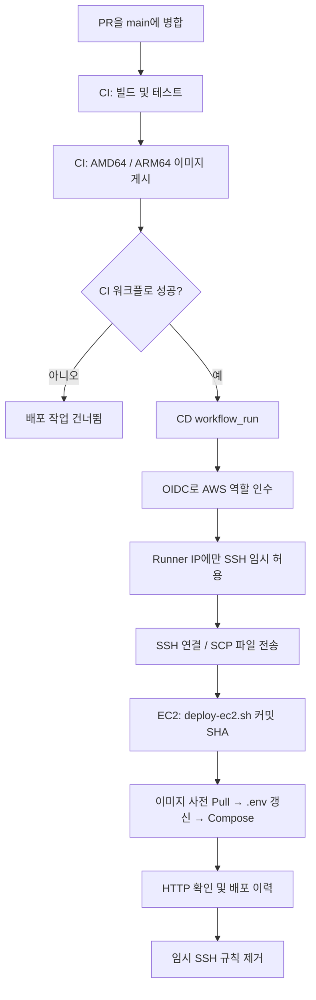

# GitHub Actions 기반 EC2 자동 배포(CD)

> 기록 기준: 2026-11-13 · MyShelf SSH 기반 CD 1차 구축 완료
>
> 관련 구현: `.github/workflows/ci.yaml`, `.github/workflows/cd.yaml`, `scripts/deploy-ec2.sh`, `compose.yaml`, `compose.prod.yaml`

## 1. 목표와 범위

MyShelf는 기존에 CI에서 Java 애플리케이션을 검증하고 GHCR에 Docker 이미지를 게시한 뒤 EC2에서 수동으로 이미지를 교체했다. 이 단계에서는 **`main` 브랜치의 CI 성공을 조건으로, CI가 게시한 바로 그 커밋의 이미지를 EC2에 자동 배포**하도록 연결했다.

이 문서는 *어느 이벤트가 배포를 시작하고 어떤 이미지 버전을 선택하는가*에 집중한다. AWS 권한 인증은 [GitHub OIDC와 AWS IAM](github-oidc-aws-iam.md), EC2에서의 실제 작업은 [EC2 자동 배포 스크립트](ec2-automated-deployment.md)를 참고한다.

### 구성요소의 책임

| 구성요소 | 책임 |
| --- | --- |
| `ci.yaml` | 빌드·테스트, 멀티 아키텍처 이미지 빌드, GHCR 게시 |
| GHCR | `sha-<Git 커밋 SHA>` 태그 이미지 보관 |
| `cd.yaml` | CI 결과 확인, AWS 인증, EC2 접속, 파일 전송, 원격 스크립트 실행 및 정리 |
| `deploy-ec2.sh` | 이미지 Pull, `.env` 갱신, Compose 실행, HTTP 확인, 이력 기록 |
| EC2 | `app`·`postgres`·`redis` 컨테이너 실행 |

## 2. 전체 흐름



`CI → CD`는 코드상의 직접 함수 호출이 아니라, GitHub Actions의 **워크플로 완료 이벤트**를 이용한 연결이다.

## 3. 왜 `workflow_run`인가?

`main`에 코드를 푸시했다는 사실만으로 배포하면, 테스트 실패 또는 이미지 게시 실패에도 배포가 시작될 수 있다. `workflow_run`을 사용하면 **선행 CI 워크플로가 완료되었음을 확인한 뒤**, 성공 여부를 검사할 수 있다.

```yaml
name: CD EC2 Deployment

on:
  workflow_run:
    workflows: ["CI"]
    types:
      - completed
```

- `workflows: ["CI"]`: `ci.yaml` **파일 이름이 아니라 최상위 `name:` 값**을 지정한다.
- `completed`: 성공·실패·취소 등 완료 시점에 발생한다. **이 설정만으로 성공한 CI만 선택되지는 않는다.**
- `workflow_run` 워크플로 파일은 기본 브랜치에 존재해야 이벤트로 실행된다. 따라서 기능 브랜치에서 작성한 파일은 `main`에 병합한 뒤 최종 연동을 확인했다.

### 3.1. 배포 Job 제한

```yaml
jobs:
  deploy:
    if: >-
      github.event.workflow_run.conclusion == 'success' &&
      github.event.workflow_run.event == 'push' &&
      github.event.workflow_run.head_branch == 'main' &&
      github.event.workflow_run.head_repository.full_name == 'pickylemon/myshelf'
```

| 조건 | 이유 |
| --- | --- |
| `conclusion == 'success'` | CI 실패 시 배포 금지 |
| `event == 'push'` | PR 검증으로 실행된 CI는 배포 대상에서 제외 |
| `head_branch == 'main'` | `main`에 반영된 버전만 배포 |
| `head_repository.full_name` | 출처가 의도한 저장소인지 확인 |

즉, PR을 생성하거나 Draft PR에 Push했을 때에는 CI는 실행될 수 있어도 **운영 EC2 배포 Job은 실행하지 않는다**. PR 병합 후 `main` Push에 대한 CI가 성공하면 CD Job이 실행된다.

> 참고: `workflow_run`의 `GITHUB_SHA`는 기본 브랜치 커밋을 나타낼 수 있다. 실제 선행 CI가 검사한 커밋을 얻으려면 `github.event.workflow_run.head_sha`를 사용해야 한다.

## 4. CI와 CD가 같은 버전을 사용하는 방법

CI는 커밋 SHA를 포함하는 이미지 태그를 생성한다.

```text
ghcr.io/pickylemon/myshelf:sha-<40자리 Git 커밋 SHA>
```

CD는 선행 CI의 커밋 SHA를 배포 스크립트에 전달한다.

```yaml
- name: Checkout deployment revision
  uses: actions/checkout@v7
  with:
    ref: ${{ github.event.workflow_run.head_sha }}

# Deploy MyShelf 단계의 환경변수
DEPLOY_SHA: ${{ github.event.workflow_run.head_sha }}
```

GitHub Actions Runner에서 SSH를 사용해 다음과 같이 EC2에 인자를 전달한다.

```bash
ssh ... "$EC2_USER@$EC2_HOST" \
  "bash /opt/myshelf/deploy-ec2.sh '$DEPLOY_SHA'"
```

EC2의 스크립트는 첫 번째 인자를 읽는다.

```bash
DEPLOY_SHA="${1:-}"
NEW_IMAGE="ghcr.io/pickylemon/myshelf:sha-${DEPLOY_SHA}"
```

따라서 이미지 태그를 YAML이나 `.env`에 하드코딩하지 않아도 **CI가 게시한 커밋과 CD가 배포하는 커밋을 연결**할 수 있다.

### Git SHA와 Docker Digest

- Git SHA: **어느 소스 커밋인지** 식별한다.
- 이미지 태그 `sha-<Git SHA>`: 해당 커밋의 이미지에 붙인 **레지스트리상의 이름**이다. 태그 자체의 불변성이 자동 보장되는 것은 아니다.
- Docker Digest `sha256:...`: 이미지 또는 멀티 플랫폼 매니페스트의 **내용 기반 식별자**다.
- 현재 배포는 **Git SHA 기반 태그**를 선택해 사용한다. Digest로 고정한 배포는 이번 범위에 포함하지 않았다.

## 5. CD 워크플로 실행 단계

| 순서 | GitHub Actions 단계 | 목적 |
| --- | --- | --- |
| 1 | Checkout deployment revision | CI 커밋과 동일한 배포 파일 확보 |
| 2 | Configure AWS credentials | GitHub OIDC로 AWS 임시 자격 증명 획득 |
| 3 | Get runner public IP | GitHub-hosted Runner의 공인 IPv4 조회 |
| 4 | Allow runner SSH access | Runner IP `/32`에 22번 포트 임시 개방 |
| 5 | Configure SSH | 개인 키·호스트 키 검증 설정 |
| 6 | Test EC2 SSH connection | 원격 접속 검증 |
| 7 | Upload deployment files | Compose 파일 및 스크립트를 SCP 전송 |
| 8 | Deploy MyShelf | 커밋 SHA를 인자로 원격 배포 수행 |
| 9 | Remove runner SSH access | 임시 보안 그룹 규칙 삭제 |

`concurrency` 그룹을 사용해 동일 EC2에 두 배포가 **동시에 실행되는 위험**을 줄인다. 단, GitHub Actions의 동시성 그룹은 엄격한 순차 큐나 '항상 최신 커밋만 배포'를 보장하지 않는다. 더 복잡한 동시 배포 요구가 생기면 별도 보완이 필요하다.

## 6. 배포 성공의 의미

`CD` Job 성공은 **해당 워크플로 안에서 정의한 검증을 통과했다**는 의미다. 현재의 핵심 검증은 다음과 같다.

1. 새 이미지 Pull 성공
2. Docker Compose 명령 성공
3. 실행 중인 `app` 컨테이너의 이미지 태그가 목표 태그와 일치
4. `http://127.0.0.1:8080/v3/api-docs` HTTP 확인 성공
5. 배포 성공 이력 기록
6. 임시 SSH 보안 그룹 규칙 삭제 성공

이 검증은 **기본 배포 확인**이지 전체 비즈니스 API, 데이터 영속성, 성능, 장애 자동 복구까지 보장하지는 않는다.

## 7. 실제 최초 통합 검증

- 검증일: **2026-11-13**
- `main` 병합에 따른 **CI #46 성공**
- 이어서 **CD EC2 Deployment #1 성공**
- 배포한 커밋 SHA: `c19bca5dda852b0dc08e24578e54fb0ee9e975ac`
- EC2 `.env`, `.last-successful-image`, `docker compose ps`, `docker inspect`에서 동일 태그 확인
- `curl http://127.0.0.1:8080/v3/api-docs`: **HTTP 200**
- CD의 `Remove runner SSH access`: 성공 (보안 그룹 규칙 삭제 반환 `true`)
- 기존 PostgreSQL·Redis 컨테이너는 해당 배포 과정에서 재생성되지 않음

이 검증으로 **CI 이미지 게시 → CD 자동 실행 → EC2에서 신규 이미지 실행**까지 연결되었음을 확인했다.

이 절은 개발자가 확인한 최초 통합 검증 기록을 모은 곳이다. EC2 내부의 상태·이력 확인 명령과 검증 한계는 [EC2 자동 배포](ec2-automated-deployment.md#6-운영-환경-검증-명령)를 참고한다. 파일과 커밋 이력으로 확인할 수 있는 구현 상태와 실제 서버에서 관찰한 결과는 구분한다.

## 8. 후속 범위

- CI 실행 시간 개선: **미구현**. 기존 CI의 실행 시간과 단계별 병목을 분석한 뒤 별도 작업으로 진행.
- AWS Systems Manager(SSM) 전환: **미구현**. SSH/SCP 및 임시 보안 그룹 조작을 대체할 예정.
- 자동 롤백·전용 Health Check·운영 메트릭: **미구현**. 운영 고도화 범위로 분리.

## 참고 자료

- [GitHub Actions - Events that trigger workflows (`workflow_run`)](https://docs.github.com/en/actions/reference/workflows-and-actions/events-that-trigger-workflows)
- [GitHub Actions - Workflow syntax](https://docs.github.com/en/actions/reference/workflows-and-actions/workflow-syntax)
- [AWS Configure Credentials Action](https://github.com/aws-actions/configure-aws-credentials)

## 관련 문서

- [GitHub Actions CI](github-actions-ci.md)
- [GitHub Container Registry](github-container-registry.md)
- [GitHub OIDC와 AWS IAM](github-oidc-aws-iam.md)
- [EC2 자동 배포 스크립트](ec2-automated-deployment.md)
- [EC2 수동 배포](ec2-manual-deployment.md)
- [CD 트러블슈팅](../../troubleshooting/github-actions-cd-troubleshooting.md)
