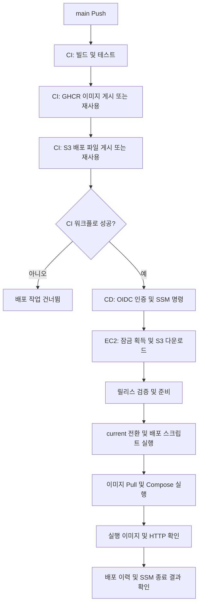

# GitHub Actions 기반 EC2 자동 배포(CD)

> 기록 기준: 2026-11-16 · SSH 기반 최초 구축 이후 S3·SSM 전환 및 정상 배포 확인
>
> 관련 구현: `.github/workflows/ci.yaml`, `.github/workflows/cd.yaml`, `scripts/deploy-ec2.sh`, `scripts/prepare-release-ec2.sh`, `scripts/activate-release-ec2.sh`, `scripts/bootstrap-release-ec2.sh`, `compose.yaml`, `compose.prod.yaml`

## 1. 목표와 범위

MyShelf는 기존에 CI에서 Java 애플리케이션을 검증하고 GHCR에 Docker 이미지를 게시한 뒤 EC2에서 수동으로 이미지를 교체했다. 이 단계에서는 **`main` 브랜치의 CI 성공을 조건으로, CI가 게시한 바로 그 커밋의 이미지를 EC2에 자동 배포**하도록 연결했다.

2026-11-16에는 파일 전달을 S3로, 원격 실행을 SSM으로 전환했다. 현재 흐름은 2~6절, SSH 방식의 최초 검증은 7절, SSM 전환 결과는 8절에 정리한다.

이 문서는 *어느 이벤트가 배포를 시작하고 어떤 이미지 버전을 선택하는가*에 집중한다. AWS 권한 인증은 [GitHub OIDC와 AWS IAM](github-oidc-aws-iam.md), EC2에서의 실제 작업은 [EC2 자동 배포 스크립트](ec2-automated-deployment.md)를 참고한다.

### 구성요소의 책임

| 구성요소 | 책임 |
| --- | --- |
| `ci.yaml` | 빌드·테스트, 이미지 게시·재사용, 동일 SHA의 S3 배포 파일 게시·재사용 |
| GHCR | `sha-<Git 커밋 SHA>` 태그 이미지 보관 |
| S3 | 같은 커밋의 Compose 파일 두 개와 준비·활성화·배포 스크립트 보관 |
| `cd.yaml` | CI 결과 확인, OIDC 인증, SSM 명령 전송 및 실제 종료 결과 확인 |
| `prepare-release-ec2.sh` | 압축 파일 검증, SHA별 릴리스 준비·재사용 |
| `activate-release-ec2.sh` | current 링크 전환, 배포 호출, 실패 시 이전 릴리스 복구 시도 |
| `bootstrap-release-ec2.sh` | 기존 운영 파일의 최초 이관. 매 배포용 S3 묶음에서는 제외 |
| `deploy-ec2.sh` | 이미지 Pull, `.env` 갱신, Compose 실행, HTTP 확인, 이력 기록 |
| EC2 | `app`·`postgres`·`redis` 컨테이너 실행 |

## 2. 전체 흐름



`CI → CD`는 코드상의 직접 함수 호출이 아니라, GitHub Actions의 **워크플로 완료 이벤트**를 이용한 연결이다.

## 3. 왜 `workflow_run`인가?

`main`에 코드를 푸시했다는 사실만으로 배포하면, 테스트 실패 또는 이미지 게시 실패에도 배포가 시작될 수 있다. `workflow_run`을 사용하면 **선행 CI 워크플로가 완료되었음을 확인한 뒤**, 성공 여부를 검사할 수 있다.

```yaml
name: CD EC2 Deployment

on:
  workflow_run:
    workflows: ["CI"]
    types:
      - completed
```

- `workflows: ["CI"]`: `ci.yaml` **파일 이름이 아니라 최상위 `name:` 값**을 지정한다.
- `completed`: 성공·실패·취소 등 완료 시점에 발생한다. **이 설정만으로 성공한 CI만 선택되지는 않는다.**
- `workflow_run` 워크플로 파일은 기본 브랜치에 존재해야 이벤트로 실행된다. 따라서 기능 브랜치에서 작성한 파일은 `main`에 병합한 뒤 최종 연동을 확인했다.

### 3.1. 배포 Job 제한

```yaml
jobs:
  deploy:
    if: >-
      github.event.workflow_run.conclusion == 'success' &&
      github.event.workflow_run.event == 'push' &&
      github.event.workflow_run.head_branch == 'main' &&
      github.event.workflow_run.head_repository.full_name == 'pickylemon/myshelf'
```

| 조건 | 이유 |
| --- | --- |
| `conclusion == 'success'` | CI 실패 시 배포 금지 |
| `event == 'push'` | PR 검증으로 실행된 CI는 배포 대상에서 제외 |
| `head_branch == 'main'` | `main`에 반영된 버전만 배포 |
| `head_repository.full_name` | 출처가 의도한 저장소인지 확인 |

즉, PR을 생성하거나 Draft PR에 Push했을 때에는 CI는 실행될 수 있어도 **운영 EC2 배포 Job은 실행하지 않는다**. PR 병합 후 `main` Push에 대한 CI가 성공하면 CD Job이 실행된다.

> 참고: `workflow_run`의 `GITHUB_SHA`는 기본 브랜치 커밋을 나타낼 수 있다. 실제 선행 CI가 검사한 커밋을 얻으려면 `github.event.workflow_run.head_sha`를 사용해야 한다.

## 4. CI와 CD가 같은 버전을 사용하는 방법

CI는 커밋 SHA를 포함하는 이미지 태그를 생성한다.

```text
ghcr.io/pickylemon/myshelf:sha-<40자리 Git 커밋 SHA>
```

CD는 선행 CI의 커밋 SHA를 배포 스크립트에 전달한다.

CD는 다음 값으로 SSM 명령의 인자를 구성한다. 현재 CD는 Git Checkout이나 SCP를 수행하지 않는다.

```yaml
DEPLOY_SHA: ${{ github.event.workflow_run.head_sha }}
```

이 SHA로 S3의 `releases/<SHA>/deploy.tar.gz`를 선택하고, EC2에 준비된 릴리스의 활성화 스크립트에 같은 값을 전달한다. 활성화 스크립트가 배포 스크립트를 한 번 호출한다.

EC2의 스크립트는 첫 번째 인자를 읽는다.

```bash
DEPLOY_SHA="${1:-}"
NEW_IMAGE="ghcr.io/pickylemon/myshelf:sha-${DEPLOY_SHA}"
```

따라서 이미지 태그를 YAML이나 `.env`에 하드코딩하지 않아도 **CI가 게시한 커밋과 CD가 배포하는 커밋을 연결**할 수 있다.

### Git SHA와 Docker Digest

- Git SHA: **어느 소스 커밋인지** 식별한다.
- 이미지 태그 `sha-<Git SHA>`: 해당 커밋의 이미지에 붙인 **레지스트리상의 이름**이다. 태그 자체의 불변성이 자동 보장되는 것은 아니다.
- Docker Digest `sha256:...`: 이미지 또는 멀티 플랫폼 매니페스트의 **내용 기반 식별자**다.
- 현재 배포는 **Git SHA 기반 태그**를 선택해 사용한다. Digest로 고정한 배포는 이번 범위에 포함하지 않았다.

## 5. CD 워크플로 실행 단계

| 순서 | 실행 위치 | 작업 |
| --- | --- | --- |
| 1 | GitHub Actions | OIDC로 AWS 임시 자격 증명 획득 |
| 2 | GitHub Actions | SHA·버킷·실행 사용자를 검증하고 SSM 명령 전송 |
| 3 | EC2 | ubuntu 사용자로 배포 잠금 획득 및 S3 다운로드 |
| 4 | EC2 | 준비 스크립트가 파일·Compose 설정 검증 후 릴리스 준비 |
| 5 | EC2 | 활성화 스크립트가 current를 전환하고 배포 스크립트 호출 |
| 6 | EC2 | 이미지 Pull·환경변수 갱신·Compose 실행·HTTP 확인 |
| 7 | GitHub Actions | SSM 실제 종료 상태와 표준 출력·오류 확인 |

SSM 요청 접수 성공과 배포 성공은 다르다. `Pending`·`InProgress`·`Delayed`·`Cancelling`이면 기다리고, `Success`이면 성공, `Failed`·`Cancelled`·`TimedOut`이면 실패 처리한다. 결과 대기 초과도 실패로 처리한다.

GitHub Actions의 concurrency와 EC2의 `flock` 잠금으로 중복 배포를 제한한다. 이는 엄격한 커밋 순서나 최신 커밋 우선 배포를 보장하지는 않는다. Runner가 기다리기를 중단해도 원격 작업이 즉시 종료된다고 간주하지 않는다.

## 6. 배포 성공의 의미

`CD` Job 성공은 **해당 워크플로 안에서 정의한 검증을 통과했다**는 의미다. 현재의 핵심 검증은 다음과 같다.

1. 새 이미지 Pull 성공
2. Docker Compose 명령 성공
3. 실행 중인 `app` 컨테이너의 이미지 태그가 목표 태그와 일치
4. `http://127.0.0.1:8080/v3/api-docs` HTTP 확인 성공
5. 배포 성공 이력 기록
6. SSM 원격 실행의 최종 성공 상태 확인

이 검증은 **기본 배포 확인**이지 전체 비즈니스 API, 데이터 영속성, 성능, 장애 자동 복구까지 보장하지는 않는다.

## 7. 실제 최초 통합 검증

- 검증일: **2026-11-13**
- `main` 병합에 따른 **CI #46 성공**
- 이어서 **CD EC2 Deployment #1 성공**
- 배포한 커밋 SHA: `c19bca5dda852b0dc08e24578e54fb0ee9e975ac`
- EC2 `.env`, `.last-successful-image`, `docker compose ps`, `docker inspect`에서 동일 태그 확인
- `curl http://127.0.0.1:8080/v3/api-docs`: **HTTP 200**
- CD의 `Remove runner SSH access`: 성공 (보안 그룹 규칙 삭제 반환 `true`)
- 기존 PostgreSQL·Redis 컨테이너는 해당 배포 과정에서 재생성되지 않음

이 검증으로 **CI 이미지 게시 → CD 자동 실행 → EC2에서 신규 이미지 실행**까지 연결되었음을 확인했다.

이 절은 개발자가 확인한 최초 통합 검증 기록을 모은 곳이다. EC2 내부의 상태·이력 확인 명령과 검증 한계는 [EC2 자동 배포](ec2-automated-deployment.md#6-운영-환경-검증-명령)를 참고한다. 파일과 커밋 이력으로 확인할 수 있는 구현 상태와 실제 서버에서 관찰한 결과는 구분한다.

## 8. SSM 전환 및 실제 배포 검증

2026-11-16, PR #36을 main에 병합하여 S3·SSM 방식으로 전환했다. 아래는 개발자가 제공한 화면·EC2 출력과 성공 확인을 근거로 한 기록이다.

| 단계 | 확인한 결과 |
| --- | --- |
| PR CI #51 | build-and-test·verify-image 성공. 게시 작업은 생략 |
| main Push CI #52 | build-and-test·publish-image·publish-artifacts-to-s3 성공 |
| 배포 대상 커밋 | `c869188` (화면에 표시된 단축 SHA) |
| 최초 CD | S3 다운로드·릴리스 준비 성공 후 `Run bootstrap first`로 실패 |
| 최초 이관 | 기존 이미지 SHA `8acdf393d996d1f6b716b037eff953296632c358`의 릴리스를 생성하고 current 연결 |
| 실패한 CD 재실행 | 개발자가 성공 확인. CI 재실행 없이 진행 |

원인은 기존 운영 파일을 새 릴리스 구조로 옮기기 전에 CD를 시작한 것이다. bootstrap을 EC2에 별도로 전달·실행한 뒤 실패한 CD만 재실행했다. [최초 이관 장애와 해결 과정](../../troubleshooting/github-actions-cd-troubleshooting.md#7-ssm-첫-배포-실패-error-run-bootstrap-first)에 실제 명령·로그와 개념을 정리했다.

정상 CD 성공은 코드에 정의된 실행 이미지·기본 HTTP 확인까지 통과했다는 의미다. 이번 기록에 CD 실행 번호·전체 배포 SHA·별도 curl 출력은 제공되지 않았으므로 추가 결과를 만들어 기록하지 않는다. SSH 최초 검증 때 관찰한 DB·Redis 유지 결과를 이번 배포의 검증 결과로 옮기지 않는다.

같은 SHA의 **CD 재실행**과 **CI 전체 재실행**은 구분한다. 이번에는 이미 준비된 EC2 릴리스를 사용하는 CD 재실행을 확인했다. GHCR 이미지·S3 아티팩트의 CI 재실행 재사용, 손상 파일 거부, 업로드 실패 전파, 실제 자동 복구는 별도 검증이 필요하다.

## 9. 후속 범위

- CI 실행 시간의 추가 개선: 단계별 병목을 측정하고 검토한다.
- 이전 릴리스 자동 복구: 코드는 구현했으며 실제 실패·복구 시나리오는 별도 검증한다. DB 마이그레이션은 복구하지 않는다.
- 전용 Health Check·운영 메트릭·HTTPS 및 외부 공개: 후속 운영 고도화로 둔다.
- SSH 관련 Secrets·인바운드 규칙·불필요한 IAM 권한 정리: 실제 정리 여부를 확인한다. 워크플로의 SSH 제거만으로 AWS 설정 정리를 완료한 것으로 보지 않는다.

## 참고 자료

- [GitHub Actions - Events that trigger workflows (`workflow_run`)](https://docs.github.com/en/actions/reference/workflows-and-actions/events-that-trigger-workflows)
- [GitHub Actions - Workflow syntax](https://docs.github.com/en/actions/reference/workflows-and-actions/workflow-syntax)
- [AWS Configure Credentials Action](https://github.com/aws-actions/configure-aws-credentials)

## 관련 문서

- [GitHub Actions CI](github-actions-ci.md)
- [GitHub Container Registry](github-container-registry.md)
- [GitHub OIDC와 AWS IAM](github-oidc-aws-iam.md)
- [EC2 자동 배포 스크립트](ec2-automated-deployment.md)
- [EC2 수동 배포](ec2-manual-deployment.md)
- [CD 트러블슈팅](../../troubleshooting/github-actions-cd-troubleshooting.md)
