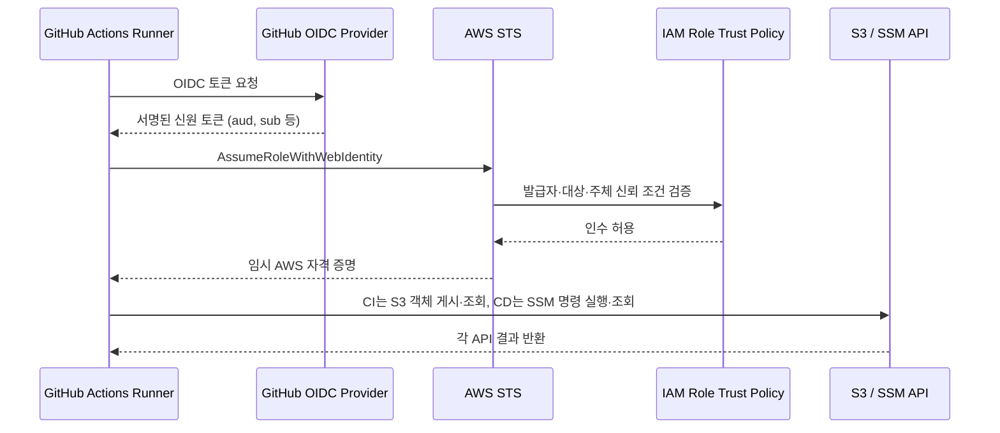

# GitHub Actions OIDC 인증과 AWS IAM 권한 설계

> 기록 기준: 2026-11-16 · SSH 구축 이력과 현재 S3·SSM 인증·접근 제어
>
> 본문의 정책 예제와 설정값은 기록 시점의 학습 자료다. 이후 현재 인증·권한 구조는 [CI/CD 아키텍처](../../architecture/ci-cd.md)와 실제 IAM·워크플로 설정에서 확인한다. 이 문서의 예제를 그대로 적용하는 현행 권한 명세로 사용하지 않는다.
>
> 핵심 질문: **GitHub Actions Runner가 장기 AWS 액세스 키 없이 어떻게 EC2 배포에 필요한 AWS API를 호출하는가?**

## 1. 배경

초기 CD는 AWS API로 SSH 인바운드 규칙을 잠시 열고 제거했다. 현재는 CI가 S3에 배포 파일을 게시하고, CD가 SSM 명령을 전송·조회한다. 이 AWS API 호출을 위해 GitHub Actions가 AWS 권한을 가져야 한다.

5~7절의 보안 그룹·SSH 설명은 기존 구축 이력이며, 현재 S3·SSM 권한은 9절에서 설명한다.

장기 보관되는 AWS Access Key를 GitHub Secret에 넣는 대신, **GitHub OIDC 토큰을 AWS가 검증하고 IAM Role의 임시 자격 증명을 발급하는 구조**를 선택했다.

## 2. 인증과 권한 부여를 분리해서 이해하기

| 항목 | 질문 | 실제 구성 |
| --- | --- | --- |
| OIDC 신원 확인 | 요청한 GitHub Actions가 누구인가? | GitHub OIDC Provider와 서명된 토큰 |
| IAM Role 신뢰 정책 | 이 주체가 역할을 인수해도 되는가? | `sts:AssumeRoleWithWebIdentity`, `aud`, `sub` 조건 |
| IAM 권한 정책 | 역할을 인수한 뒤 어떤 AWS API를 호출할 수 있는가? | 현재 S3 객체 게시·조회와 SSM 명령 실행·결과 조회 권한 |
| GitHub Job 조건 | 배포 Job을 언제 실행하는가? | `workflow_run`의 성공·Push·main·저장소 검사 |

**신뢰 정책(누가 역할을 인수하는가)**과 **권한 정책(인수한 역할이 무엇을 할 수 있는가)**은 서로 다르다. `main` 브랜치에서 실행한 워크플로라고 해도, IAM Role에 허용하지 않은 AWS API를 사용할 수는 없다.

## 3. OIDC 전체 흐름



GitHub Actions에서 사용하는 기본 설정은 다음과 같다.

```yaml
permissions:
  contents: read
  id-token: write

steps:
  - name: Configure AWS credentials
    uses: aws-actions/configure-aws-credentials@v4
    with:
      aws-region: ap-northeast-2
      role-to-assume: ${{ vars.AWS_CD_ROLE_ARN }}
```

- `id-token: write`: OIDC 토큰을 요청할 권한이다. 저장소 코드를 수정하는 권한을 의미하지 않는다.
- `contents: read`: Checkout 등 저장소 파일 읽기용 권한이다.
- `AWS_CD_ROLE_ARN`: 어떤 IAM Role을 인수할지 식별한다. Role ARN 자체는 비밀키가 아니므로 Repository Variable로 관리한다.
- 임시 AWS 자격 증명은 Action이 발급받아 해당 Job에서 사용한다. **고정 AWS Access Key를 GitHub Secret에 저장하지 않는다.**

## 4. IAM 신뢰 정책: `aud`와 `sub`

현재 MyShelf의 CD 역할은 `main` 브랜치에서 실행되는 GitHub Actions를 허용한다.

```json
{
  "Version": "2012-10-17",
  "Statement": [
    {
      "Effect": "Allow",
      "Principal": {
        "Federated": "arn:aws:iam::<AWS_ACCOUNT_ID>:oidc-provider/token.actions.githubusercontent.com"
      },
      "Action": "sts:AssumeRoleWithWebIdentity",
      "Condition": {
        "StringEquals": {
          "token.actions.githubusercontent.com:aud": "sts.amazonaws.com",
          "token.actions.githubusercontent.com:sub": "repo:pickylemon@156510800/myshelf@1380837269:ref:refs/heads/main"
        }
      }
    }
  ]
}
```

위 예시는 **핵심 구조를 설명하기 위한 예시**다. AWS 계정 ID·Role ARN·정확한 정책은 실제 계정에서 관리하고, 문서에는 비밀값을 기록하지 않는다.

- `aud`(Audience): 토큰이 `sts.amazonaws.com`을 대상으로 발급되었는가?
- `sub`(Subject): 어느 저장소의 어떤 브랜치에서 실행된 작업인가?
- 현재 주체 값에 포함된 `@숫자ID`는 실제 발급된 토큰에서 확인한 **변경 불가능한 소유자·저장소 ID를 포함한 형식**이다. GitHub의 저장소 생성 시점 및 OIDC 설정에 따라 형식이 다를 수 있으므로, 다른 저장소에 이 값을 그대로 복사하지 않는다.

### 브랜치 제한의 실제 의미

```text
GitHub Actions 실행 브랜치 = main              → 역할 인수 가능
GitHub Actions 실행 브랜치 = cd/ec2-deployment → 역할 인수 거부
```

이것은 **AWS IAM Role을 사용할 수 있는 실행 주체의 제한**이지, EC2에서 어떤 Git 브랜치의 코드를 실행할지를 직접 선택하는 설정은 아니다. 또한 `main`만 지정했다고 해서 `cd.yaml`이라는 파일만 허용되는 것은 아니다. 그 브랜치에서 실행되는 **다른 워크플로도 동일한 OIDC 조건을 충족할 수 있다**. 그래서 GitHub Job 조건과 최소 권한 정책을 함께 관리한다.

## 5. 기존 SSH 방식의 IAM 권한과 리소스 범위

초기 SSH 배포에서 GitHub Actions가 직접 호출했던 주요 AWS API는 다음과 같다.

| API | 목적 |
| --- | --- |
| `ec2:AuthorizeSecurityGroupIngress` | Runner 공인 IP의 `/32`에 대해 SSH 22번 포트 인바운드 허용 |
| `ec2:RevokeSecurityGroupIngress` | 배포 종료 후 해당 규칙 제거 |

이 권한은 **대상 EC2 인스턴스 ID가 아니라 대상 Security Group 리소스**에 맞게 설정해야 한다. 실제 구축 과정에서 인스턴스와 보안 그룹의 리소스 대상을 혼동했을 때 권한 오류를 겪었다.

정책의 범위는 가능하면 **해당 EC2에 연결된 특정 보안 그룹**으로 제한한다. 역할에 `ec2:*` 또는 전 리소스에 대한 광범위한 권한을 주지 않는다. 정확한 IAM 정책은 저장소에 비밀정보 없이 별도 관리되는 정책 원본과 대조해야 한다.

## 6. 기존 방식에서 Runner IP에만 SSH 포트를 임시 개방한 이유

GitHub-hosted Runner는 실행할 때마다 공인 IP가 달라질 수 있다. 따라서 고정된 관리 PC의 IP만 허용할 수 없고, 그렇다고 운영 EC2의 22번 포트를 `0.0.0.0/0`에 상시 개방하는 것도 피해야 한다.

SSM 전환 전에 사용한 흐름은 다음과 같다.

1. Runner에서 `curl -4 -fsS https://checkip.amazonaws.com`으로 공인 IPv4 조회
2. `aws ec2 authorize-security-group-ingress`로 `RunnerIP/32`의 TCP 22번 허용
3. 반환된 **Security Group Rule ID** 저장
4. SSH / SCP / 배포 실행
5. `if: always()`인 정리 단계에서 해당 Rule ID 삭제

```yaml
- name: Remove runner SSH access
  if: ${{ always() && steps.allow-ssh.outputs.rule_id != '' }}
```

`always()`는 일반적인 선행 단계 실패에도 정리를 시도하도록 돕지만, Runner 자체의 비정상 종료나 AWS 장애까지 포함하여 **규칙 삭제가 100% 보장되는 것은 아니다**. 따라서 필요 시 보안 그룹에 남은 임시 22번 규칙을 점검할 운영 절차도 필요하다.

## 7. 기존 SSH 자격 증명과 호스트 검증

OIDC는 AWS API 인증에 사용되고, **실제 EC2의 SSH 로그인에는 별도 SSH 키**가 사용된다. 두 인증은 다른 계층에 속한다.

| 이름 | 저장 위치 | 용도 |
| --- | --- | --- |
| `AWS_CD_ROLE_ARN` | GitHub Actions Variable | AWS Role 식별 |
| `EC2_SG_ID` | GitHub Actions Variable | 임시 허용할 보안 그룹 |
| `EC2_HOST` / `EC2_USER` | GitHub Actions Variable | 접속 대상 및 사용자 |
| `EC2_SSH_HOST_KEY` | GitHub Actions Variable | 서버 공개 호스트 키 검증 |
| `EC2_SSH_PRIVATE_KEY` | GitHub Actions Secret | EC2 로그인용 비밀 개인 키 |

GitHub Actions에서 `StrictHostKeyChecking=yes`를 사용해 알려진 EC2 호스트 키와 접속 대상이 일치하는지 확인한다. SSH 개인 키와 JWT 비밀 키, DB 비밀번호 등을 워크플로 로그 또는 문서에 출력하지 않는다.

> 참고: EC2 `.env`에는 앱이 사용하는 `DB_PASSWORD`, `JWT_SECRET`, 외부 API 키 등이 있고, **SCP로 `.env`를 복사하지 않는다**. 배포 중에는 `MYSHELF_IMAGE` 항목만 갱신한다.

## 8. 실제 오류에서 배운 내용

역할 인수 실패를 진단할 때는 **실행 주체의 `sub`와 신뢰 정책 조건을 먼저 대조**한다. 같은 오류라도 OIDC Provider, Audience, Role ARN 등 원인이 다를 수 있다. 이번에 겪은 브랜치 불일치의 증상·원인·해결 과정은 [CD 트러블슈팅 1절](../../troubleshooting/github-actions-cd-troubleshooting.md#1-oidc-역할-인수-실패-stsassumerolewithwebidentity)에 모아 둔다.

## 9. 현재 S3·SSM 방식의 권한과 인증

2026-11-16 PR #36에서 S3·SSM 방식으로 전환했다. 현재 워크플로에서는 Runner IP 조회·임시 22번 개방·SSH/SCP·규칙 삭제를 제거했다. EC2의 SSM Agent와 IAM Role, CI의 S3 게시, CD의 Run Command를 사용한다.

| 실행 주체 | 필요한 작업 |
| --- | --- |
| CI의 S3 게시 Job | OIDC로 역할 인수, 대상 경로의 `s3:PutObject`, 기존 객체 비교용 `s3:GetObject` |
| CD Job | OIDC로 역할 인수, 대상 EC2·허용된 SSM 문서의 `ssm:SendCommand`, `ssm:GetCommandInvocation` |
| EC2 인스턴스 Role | SSM Agent 연결 권한과 배포 아티팩트 `s3:GetObject` |

실제 다운로드 방식·오류 조회·암호화 설정에 따라 추가 권한이 필요할 수 있다. 정책 원본을 확인하지 않고 위 표만으로 전체 AWS 권한을 검증했다고 간주하지 않는다. 버킷·객체 경로·대상 인스턴스·명령 문서로 범위를 제한한다.

현재 YAML은 CI의 S3 게시 Job과 CD 모두 `AWS_CD_ROLE_ARN`을 사용한다. GitHub의 `id-token: write`는 필요한 Job에만 부여하지만, 같은 IAM Role을 인수하면 그 Role에 설정된 AWS 권한을 공유한다. Job별 토큰 권한과 IAM Role의 권한 분리는 별개다.

PR 테스트에는 OIDC 쓰기 권한을 추가하지 않았다. main의 CI 게시 Job에서도 Role을 인수하므로 신뢰 정책이 해당 실행 주체를 허용해야 한다. main만 허용하는 기존 OIDC 원칙은 유지한다.

SSM은 root 권한으로 명령을 받고 현재 워크플로는 `sudo -u`로 기존 ubuntu 사용자에게 다운로드·배포를 맡긴다. Docker 명령은 기존 `sudo -n docker` 경로를 사용한다. AWS IAM 인증과 비공개 GHCR 인증은 별개이므로 Docker의 GHCR 인증도 유지해야 한다.

현재 사용 변수는 `AWS_CD_ROLE_ARN`, `S3_DEPLOY_BUCKET`, `EC2_INSTANCE_ID`, `EC2_USER`다. SSH 전용 Secrets·보안 그룹·불필요한 EC2 권한의 실제 삭제 여부는 별도로 확인한다. YAML에서 SSH Step을 지운 사실만으로 AWS 설정 정리까지 완료한 것은 아니다.

main CI #52의 이미지·S3 게시와 최초 이관 후 CD 재실행 성공은 [SSM 전환 검증 기록](github-actions-cd.md#8-ssm-전환-및-실제-배포-검증)을 참고한다.

## 참고 자료

- [GitHub Docs - Configuring OpenID Connect in AWS](https://docs.github.com/en/actions/how-tos/secure-your-work/security-harden-deployments/oidc-in-aws)
- [GitHub Docs - Immutable subject claims](https://docs.github.com/en/actions/reference/security/oidc#immutable-subject-claims)
- [aws-actions/configure-aws-credentials](https://github.com/aws-actions/configure-aws-credentials)
- [AWS IAM - Roles for OIDC](https://docs.aws.amazon.com/IAM/latest/UserGuide/id_roles_providers_create_oidc.html)

## 관련 문서

- [GitHub Actions CD](github-actions-cd.md)
- [EC2 자동 배포](ec2-automated-deployment.md)
- [CD 트러블슈팅](../../troubleshooting/github-actions-cd-troubleshooting.md)
