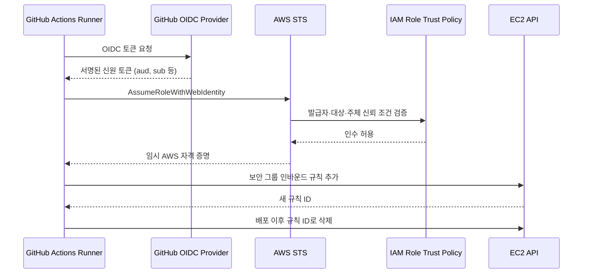

# GitHub Actions OIDC 인증과 AWS IAM 권한 설계

> 기록 기준: 2026-11-13 · MyShelf SSH 기반 CD에 적용한 인증·접근 제어
>
> 핵심 질문: **GitHub Actions Runner가 장기 AWS 액세스 키 없이 어떻게 EC2 배포에 필요한 AWS API를 호출하는가?**

## 1. 배경

MyShelf의 CD는 GitHub-hosted Runner에서 AWS API를 호출해 EC2 보안 그룹의 SSH 인바운드 규칙을 잠시 열고, 이후 규칙을 제거한다. 이때 GitHub Actions가 AWS의 권한을 가져야 한다.

장기 보관되는 AWS Access Key를 GitHub Secret에 넣는 대신, **GitHub OIDC 토큰을 AWS가 검증하고 IAM Role의 임시 자격 증명을 발급하는 구조**를 선택했다.

## 2. 인증과 권한 부여를 분리해서 이해하기

| 항목 | 질문 | 실제 구성 |
| --- | --- | --- |
| OIDC 신원 확인 | 요청한 GitHub Actions가 누구인가? | GitHub OIDC Provider와 서명된 토큰 |
| IAM Role 신뢰 정책 | 이 주체가 역할을 인수해도 되는가? | `sts:AssumeRoleWithWebIdentity`, `aud`, `sub` 조건 |
| IAM 권한 정책 | 역할을 인수한 뒤 어떤 AWS API를 호출할 수 있는가? | 특정 보안 그룹의 인바운드 규칙 추가·삭제 권한 |
| GitHub Job 조건 | 배포 Job을 언제 실행하는가? | `workflow_run`의 성공·Push·main·저장소 검사 |

**신뢰 정책(누가 역할을 인수하는가)**과 **권한 정책(인수한 역할이 무엇을 할 수 있는가)**은 서로 다르다. `main` 브랜치에서 실행한 워크플로라고 해도, IAM Role에 허용하지 않은 AWS API를 사용할 수는 없다.

## 3. OIDC 전체 흐름



GitHub Actions에서 사용하는 기본 설정은 다음과 같다.

```yaml
permissions:
  contents: read
  id-token: write

steps:
  - name: Configure AWS credentials
    uses: aws-actions/configure-aws-credentials@v4
    with:
      aws-region: ap-northeast-2
      role-to-assume: ${{ vars.AWS_CD_ROLE_ARN }}
```

- `id-token: write`: OIDC 토큰을 요청할 권한이다. 저장소 코드를 수정하는 권한을 의미하지 않는다.
- `contents: read`: Checkout 등 저장소 파일 읽기용 권한이다.
- `AWS_CD_ROLE_ARN`: 어떤 IAM Role을 인수할지 식별한다. Role ARN 자체는 비밀키가 아니므로 Repository Variable로 관리한다.
- 임시 AWS 자격 증명은 Action이 발급받아 해당 Job에서 사용한다. **고정 AWS Access Key를 GitHub Secret에 저장하지 않는다.**

## 4. IAM 신뢰 정책: `aud`와 `sub`

현재 MyShelf의 CD 역할은 `main` 브랜치에서 실행되는 GitHub Actions를 허용한다.

```json
{
  "Version": "2012-10-17",
  "Statement": [
    {
      "Effect": "Allow",
      "Principal": {
        "Federated": "arn:aws:iam::<AWS_ACCOUNT_ID>:oidc-provider/token.actions.githubusercontent.com"
      },
      "Action": "sts:AssumeRoleWithWebIdentity",
      "Condition": {
        "StringEquals": {
          "token.actions.githubusercontent.com:aud": "sts.amazonaws.com",
          "token.actions.githubusercontent.com:sub": "repo:pickylemon@156510800/myshelf@1380837269:ref:refs/heads/main"
        }
      }
    }
  ]
}
```

위 예시는 **핵심 구조를 설명하기 위한 예시**다. AWS 계정 ID·Role ARN·정확한 정책은 실제 계정에서 관리하고, 문서에는 비밀값을 기록하지 않는다.

- `aud`(Audience): 토큰이 `sts.amazonaws.com`을 대상으로 발급되었는가?
- `sub`(Subject): 어느 저장소의 어떤 브랜치에서 실행된 작업인가?
- 현재 주체 값에 포함된 `@숫자ID`는 실제 발급된 토큰에서 확인한 **변경 불가능한 소유자·저장소 ID를 포함한 형식**이다. GitHub의 저장소 생성 시점 및 OIDC 설정에 따라 형식이 다를 수 있으므로, 다른 저장소에 이 값을 그대로 복사하지 않는다.

### 브랜치 제한의 실제 의미

```text
GitHub Actions 실행 브랜치 = main              → 역할 인수 가능
GitHub Actions 실행 브랜치 = cd/ec2-deployment → 역할 인수 거부
```

이것은 **AWS IAM Role을 사용할 수 있는 실행 주체의 제한**이지, EC2에서 어떤 Git 브랜치의 코드를 실행할지를 직접 선택하는 설정은 아니다. 또한 `main`만 지정했다고 해서 `cd.yaml`이라는 파일만 허용되는 것은 아니다. 그 브랜치에서 실행되는 **다른 워크플로도 동일한 OIDC 조건을 충족할 수 있다**. 그래서 GitHub Job 조건과 최소 권한 정책을 함께 관리한다.

## 5. IAM 권한 정책과 리소스 범위

현재 SSH 배포를 위해 GitHub Actions가 직접 호출하는 주요 AWS API는 다음과 같다.

| API | 목적 |
| --- | --- |
| `ec2:AuthorizeSecurityGroupIngress` | Runner 공인 IP의 `/32`에 대해 SSH 22번 포트 인바운드 허용 |
| `ec2:RevokeSecurityGroupIngress` | 배포 종료 후 해당 규칙 제거 |

이 권한은 **대상 EC2 인스턴스 ID가 아니라 대상 Security Group 리소스**에 맞게 설정해야 한다. 실제 구축 과정에서 인스턴스와 보안 그룹의 리소스 대상을 혼동했을 때 권한 오류를 겪었다.

정책의 범위는 가능하면 **해당 EC2에 연결된 특정 보안 그룹**으로 제한한다. 역할에 `ec2:*` 또는 전 리소스에 대한 광범위한 권한을 주지 않는다. 정확한 IAM 정책은 저장소에 비밀정보 없이 별도 관리되는 정책 원본과 대조해야 한다.

## 6. Runner IP에만 SSH 포트를 임시 개방하는 이유

GitHub-hosted Runner는 실행할 때마다 공인 IP가 달라질 수 있다. 따라서 고정된 관리 PC의 IP만 허용할 수 없고, 그렇다고 운영 EC2의 22번 포트를 `0.0.0.0/0`에 상시 개방하는 것도 피해야 한다.

현재 구현은 다음과 같다.

1. Runner에서 `curl -4 -fsS https://checkip.amazonaws.com`으로 공인 IPv4 조회
2. `aws ec2 authorize-security-group-ingress`로 `RunnerIP/32`의 TCP 22번 허용
3. 반환된 **Security Group Rule ID** 저장
4. SSH / SCP / 배포 실행
5. `if: always()`인 정리 단계에서 해당 Rule ID 삭제

```yaml
- name: Remove runner SSH access
  if: ${{ always() && steps.allow-ssh.outputs.rule_id != '' }}
```

`always()`는 일반적인 선행 단계 실패에도 정리를 시도하도록 돕지만, Runner 자체의 비정상 종료나 AWS 장애까지 포함하여 **규칙 삭제가 100% 보장되는 것은 아니다**. 따라서 필요 시 보안 그룹에 남은 임시 22번 규칙을 점검할 운영 절차도 필요하다.

## 7. SSH 자격 증명과 호스트 검증

OIDC는 AWS API 인증에 사용되고, **실제 EC2의 SSH 로그인에는 별도 SSH 키**가 사용된다. 두 인증은 다른 계층에 속한다.

| 이름 | 저장 위치 | 용도 |
| --- | --- | --- |
| `AWS_CD_ROLE_ARN` | GitHub Actions Variable | AWS Role 식별 |
| `EC2_SG_ID` | GitHub Actions Variable | 임시 허용할 보안 그룹 |
| `EC2_HOST` / `EC2_USER` | GitHub Actions Variable | 접속 대상 및 사용자 |
| `EC2_SSH_HOST_KEY` | GitHub Actions Variable | 서버 공개 호스트 키 검증 |
| `EC2_SSH_PRIVATE_KEY` | GitHub Actions Secret | EC2 로그인용 비밀 개인 키 |

GitHub Actions에서 `StrictHostKeyChecking=yes`를 사용해 알려진 EC2 호스트 키와 접속 대상이 일치하는지 확인한다. SSH 개인 키와 JWT 비밀 키, DB 비밀번호 등을 워크플로 로그 또는 문서에 출력하지 않는다.

> 참고: EC2 `.env`에는 앱이 사용하는 `DB_PASSWORD`, `JWT_SECRET`, 외부 API 키 등이 있고, **SCP로 `.env`를 복사하지 않는다**. 배포 중에는 `MYSHELF_IMAGE` 항목만 갱신한다.

## 8. 실제 오류에서 배운 내용

역할 인수 실패를 진단할 때는 **실행 주체의 `sub`와 신뢰 정책 조건을 먼저 대조**한다. 같은 오류라도 OIDC Provider, Audience, Role ARN 등 원인이 다를 수 있다. 이번에 겪은 브랜치 불일치의 증상·원인·해결 과정은 [CD 트러블슈팅 1절](../../troubleshooting/github-actions-cd-troubleshooting.md#1-oidc-역할-인수-실패-stsassumerolewithwebidentity)에 모아 둔다.

## 9. SSM 전환 시 변경되는 부분 (미구현)

SSH→SSM 전환 후에는 `Runner IP 조회 → 보안 그룹 22번 임시 개방 → SSH/SCP → 규칙 삭제`를 제거할 수 있다. 대신 EC2 인스턴스 프로파일, SSM Agent 연결, Run Command 전송·결과 조회, 배포 파일 공급 방식이 필요하다.

SSM 전환을 아직 완료하지 않았으므로 현재 문서의 **실제 구현 상태는 SSH 기반 CD**이다.

## 참고 자료

- [GitHub Docs - Configuring OpenID Connect in AWS](https://docs.github.com/en/actions/how-tos/secure-your-work/security-harden-deployments/oidc-in-aws)
- [GitHub Docs - Immutable subject claims](https://docs.github.com/en/actions/reference/security/oidc#immutable-subject-claims)
- [aws-actions/configure-aws-credentials](https://github.com/aws-actions/configure-aws-credentials)
- [AWS IAM - Roles for OIDC](https://docs.aws.amazon.com/IAM/latest/UserGuide/id_roles_providers_create_oidc.html)

## 관련 문서

- [GitHub Actions CD](github-actions-cd.md)
- [EC2 자동 배포](ec2-automated-deployment.md)
- [CD 트러블슈팅](../../troubleshooting/github-actions-cd-troubleshooting.md)
